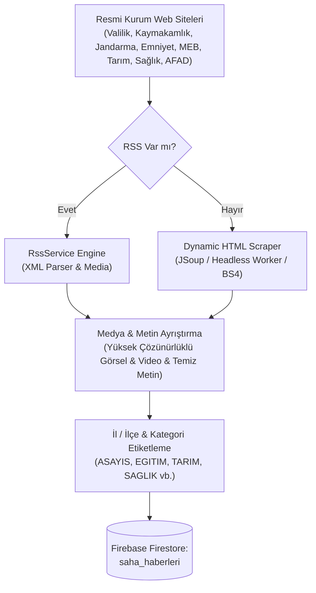

# 📡 NOVRA SAHA BOTU (NOVRA FIELD BOT)
**NOVRA A.İ. - Versiyon 1.4.1 Kapsamlı Proje**  
**Hazırlayan:** Muhammed Yasin KORKUT ve Beyza KARAKAŞ  
**Tarih:** 14.10.2026

---

## 🎯 1. Amaç ve Çalışma Mantığı
Türkiye'deki **81 il ve 922 ilçede** bulunan tüm kamu kurumlarının anlık haber ve duyurularını tek bir merkezden izlemek ve kategorilendirmek amacıyla geliştirilmiştir.

### İzlenen Resmi Kurum Ağı:
- 🏛️ **Valilikler & Kaymakamlıklar** (İçişleri Bakanlığı İSAY Portalı)
- 🛡️ **İl Jandarma Komutanlıkları** (Asayiş, Huzur Operasyonları, Güvenlik)
- 🚓 **İl Emniyet Müdürlükleri** (Polis, Trafik Denetimleri, Narkotik, Kaçakçılık)
- 📚 **İl & İlçe Milli Eğitim Müdürlükleri (MEB)** (Okullar, Sınavlar, Projeler, Öğretmen/Öğrenci)
- 🌾 **İl & İlçe Tarım ve Orman Müdürlükleri** (Çiftçi Destekleri, Hasat, Hayvancılık, Aşı/Mera)
- 🏥 **İl Sağlık Müdürlükleri** (Hastaneler, Poliklinikler, MHRS, Aşı, Halk Sağlığı)
- 🚨 **İl AFAD Müdürlükleri** (Deprem, Sel, Fırtına, Tatbikatlar, Acil Durumlar)
- 🏙️ **Belediyeler** (Büyükşehir, İl ve İlçe Belediyeleri)

Bot; haberlerin metinsel içeriğini, yüksek çözünürlüklü görsellerini ve videolarını otomatik ayıklar, kurum tipine ve içeriğe göre **kategorilendirir**, il/ilçe etiketlerini ekler ve **Firebase Firestore** üzerindeki `saha_haberleri` koleksiyonuna tekil kayıt olarak işler.

---

## 🏷️ 2. Kategorilendirme Sistemi

Her haber metni ve kurumu taranırken otomatik olarak aşağıdaki kategorilere sınıflandırılır:

| Kategori Kodu | Kategori Adı | Kapsam |
| :--- | :--- | :--- |
| `ASAYIS_GUVENLIK` | Asayiş ve Güvenlik | Jandarma, Polis, Narkotik, Kaçakçılık, Yakalanan Şahıslar, Trafik Denetimleri |
| `EGITIM` | Eğitim ve Okul | MEB haberleri, LGS/YKS, Okul açılışları, Projeler, Burslar, Seminerler |
| `TARIM_HAYVANCILIK` | Tarım ve Hayvancılık | Tarım/Orman haberleri, Çiftçi destekleri, Hasat, Şap aşısı, Tohum, Mera |
| `SAGLIK` | Sağlık ve Tıp | İl Sağlık Müdürlüğü haberleri, Hastaneler, Poliklinikler, Aşı, Randevu |
| `AFET_ACIL` | Afet ve Acil Durum | AFAD duyuruları, Deprem tatbikatları, Meteoroloji uyarıları, Sel/Fırtına |
| `BELEDIYE_HIZMET` | Belediye ve Şehircilik | Yol asfaltlama, Park/Bahçe, Altyapı, Su kesintileri, Sosyal yardımlar |
| `RESMI_DUYURU` | Resmi Duyuru ve İlan | Valilik ve Kaymakamlık emirleri, İhaleler, Personel alımı, Askı ilanları |
| `KULTUR_SANAT` | Kültür, Sanat ve Turizm | Festivaller, Konserler, Tiyatrolar, Sergiler, Yarışmalar |
| `GUNCEL` | Güncel ve Diğer | Genel yerel kamu haberleri |

---

## 🏗️ 3. Akış Mimarisi



---

## 🚀 4. Kurulum ve Çalıştırma

### Bağımlılıkları Yükleme:
```bash
pip install -r requirements.txt
```

### Parametreli Çalıştırma Seçenekleri:

```bash
# 1. Rotasyonel Tarama (Günün saatine göre 10'arlı il grubu - Otonom mod)
python saha_bot.py --rotasyon

# 2. Belirli bir ilin tüm kurumlarını tara (Örn: Adıyaman - Plaka 2)
python saha_bot.py --plaka 2

# 3. Sadece Jandarma ve Emniyet haberlerini tara:
python saha_bot.py --kurum-tipi jandarma
python saha_bot.py --kurum-tipi emniyet

# 4. Sadece Eğitim (MEB) haberlerini tara:
python saha_bot.py --kurum-tipi meb --plaka 2

# 5. Sadece Tarım ve Orman haberlerini tara:
python saha_bot.py --kurum-tipi tarim

# 6. Sadece Sağlık veya AFAD haberlerini tara:
python saha_bot.py --kurum-tipi saglik
python saha_bot.py --kurum-tipi afad

# 7. Dry-Run / Test Modu (Firebase yerine yerel 'saha_haberleri_test.json' dosyasına yazar)
python saha_bot.py --plaka 2 --dry-run
```

---

## ⚙️ 5. GitHub Actions ile Otonom Çalışma
`.github/workflows/novra_saha.yml` dosyası yapılandırılmıştır:
- **Zamanlanmış (Cron):** Her 15 dakikada bir otomatik rotasyon ile tüm kurumları periyodik olarak tarar.
- **Manuel Tetikleme (Workflow Dispatch):** GitHub Actions sekmesinden tek tıkla `mod` (rotasyon, tek_il, hepsi) ve `kurum_tipi` (jandarma, emniyet, meb, tarim, saglik, afad, valilik vb.) seçilerek anlık başlatılabilir.
- **Gizli Anahtar (Secret):** GitHub Repository Settings -> Secrets and variables -> Actions kısmına `FIREBASE_SERVICE_ACCOUNT` eklenmelidir.
