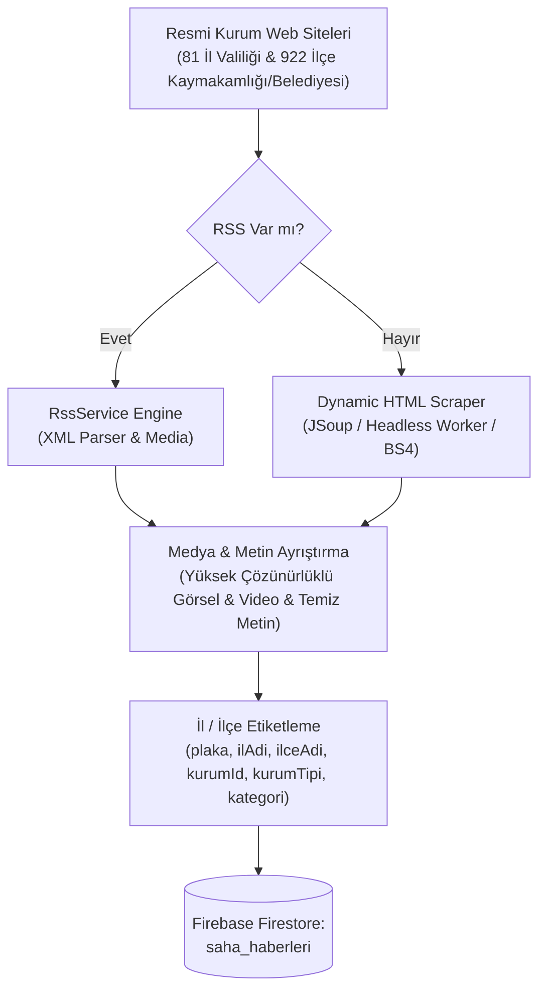

# 📡 NOVRA SAHA BOTU (NOVRA FIELD BOT)
**NOVRA A.İ. - Versiyon 1.4 Kapsamlı Proje**  
**Hazırlayan:** Muhammed Yasin KORKUT ve Beyza KARAKAŞ
**Tarih:** 14.10.2026

---

## 🎯 1. Amaç ve Çalışma Mantığı
Türkiye'deki **81 il ve 922 ilçede** bulunan tüm resmi kamu kurumlarının (Valilikler, Kaymakamlıklar, Belediyeler, Emniyet, Jandarma vb.) duyuru ve haberlerini anlık izlemek amacıyla geliştirilmiştir. 

Bot; haberlerin metinsel içeriğini, yüksek çözünürlüklü görsellerini ve varsa videolarını otomatik ayıklar, il/ilçe düzeyinde etiketler ve **Firebase Firestore** üzerindeki `saha_haberleri` koleksiyonuna tekil kayıt olarak işler.

---

## 🏗️ 2. Akış Mimarisi



---

## 🧩 3. Mimari Bileşenler

### 1. `[ Resmi Kurum Web Siteleri ]`
- **81 İl Valiliği:** `http://www.{il_slug}.gov.tr/haberler`
- **922 İlçe Kaymakamlığı:** `http://www.{ilce_slug}.gov.tr/haberler`
- **Belediyeler:** `https://www.{ilce_slug}.bel.tr/haberler`
- `turkiye_il_ilce.json` üzerinden Türkiye'nin tüm yerleşim yerlerinin haritası dinamik olarak yönetilir.

### 2. `[ RSS Var mı? ]` Karar Motoru
- Kurum web sitesine ulaşıldığında, önce HTML `<head>` içeriğindeki `<link rel="alternate" type="application/rss+xml">` etiketleri ve yaygın `/rss`, `/feed`, `/rss.xml` uç noktaları taranır.
- RSS mevcutsa **RssService Engine** devreye girer.
- RSS mevcut değilse **Dynamic HTML Scraper** devreye girer.

### 3. `[ RssService Engine ]`
- `feedparser` ile standart XML ayrıştırma.
- `<enclosure>`, `<media:content>`, `<media:thumbnail>` etiketlerinden medya çıkarma.
- Özet HTML içerisindeki görselleri ve gömülü medyayı çözme.

### 4. `[ Dynamic HTML Scraper ]`
- T.C. İçişleri Bakanlığı İSAY portal şablonu (`ISAY_GOV_TR`), standart belediye şablonları (`BELEDIYE_STANDART`) ve genel kurum şablonları.
- Liste sayfalarından son haber linklerini ayıklama ve detay sayfalarına girerek başlık, metin, galeri ve video tespiti.

### 5. `[ Medya & Metin Ayrıştırma ]`
- **Yüksek Çözünürlüklü Görsel Kalite Motoru:** Küçük boyutlu küçük resimleri (`/kucuk/` -> `/buyuk/`, `_thumb`, `_kucuk` temizleme, URL kırpma parametrelerini silme) orijinal yüksek kaliteye yükseltir. Logo, bayrak, arma ve reklam görsellerini filtreler.
- **Video Ayıklama:** HTML5 `<video>`, YouTube ve Vimeo iframe oynatıcılarını ve doğrudan MP4 linklerini ayıklar.
- **Metin Temizleme & Kategori Tespiti:** HTML etiketlerini ve gereksiz boşlukları arındırır, içeriğe göre otomatik kategori (`ASAYIS`, `EGITIM`, `SAGLIK`, `DUYURU`, `KULTUR_SANAT`, `TARIM`, `GUNCEL`) atar.

### 6. `[ İl / İlçe Etiketleme ]`
- Her habere `ilKodu`, `ilAdi`, `ilceAdi`, `kurumId`, `kurumAdi`, `kurumTipi`, `etiketler` atanır.

### 7. `[ Firebase Firestore: saha_haberleri ]`
- Her haberin linkinden üretilen tekil SHA-256 hash'i doküman ID olarak kullanılır (`merge=True` ile veri tekrarı önlenir).
- Toplu yazımlar (batching) Firestore sınırlarına uygun olarak 350'şerli gruplar halinde işlenir.

---

## 🚀 4. Kurulum ve Çalıştırma

### Bağımlılıkları Yükleme:
```bash
pip install -r requirements.txt
```

### Parametreli Çalıştırma Seçenekleri:

```bash
# 1. Rotasyonel Tarama (Günün saatine göre 10'arlı il grupları - Otonom mod)
python saha_bot.py --rotasyon

# 2. Belirli bir ilin tüm kurumlarını tara (Örn: Adıyaman - Plaka 2)
python saha_bot.py --plaka 2

# 3. Belirli bir plaka aralığını tara (Örn: 1 ile 10 arası iller)
python saha_bot.py --plaka-aralik 1-10

# 4. Belirli bir ilçeyi tara (Örn: Kâhta)
python saha_bot.py --ilce kahta

# 5. Tüm 81 il ve ilçeleri tara
python saha_bot.py --hepsi

# 6. Dry-Run / Test Modu (Firebase yerine yerel 'saha_haberleri_test.json' dosyasına yazar)
python saha_bot.py --plaka 2 --dry-run
```

---

## ⚙️ 5. GitHub Actions ile Otonom Çalışma
`.github/workflows/novra_saha.yml` dosyası yapılandırılmıştır:
- **Zamanlanmış (Cron):** Her 15 dakikada bir otomatik rotasyon ile 81 ili periyodik olarak tarar.
- **Manuel (Workflow Dispatch):** GitHub Actions sekmesinden tek tıkla istenen il veya mod seçilerek anlık başlatılabilir.
- **Gizli Anahtar (Secret):** GitHub Repository Settings -> Secrets and variables -> Actions kısmına `FIREBASE_SERVICE_ACCOUNT` eklenmelidir.
